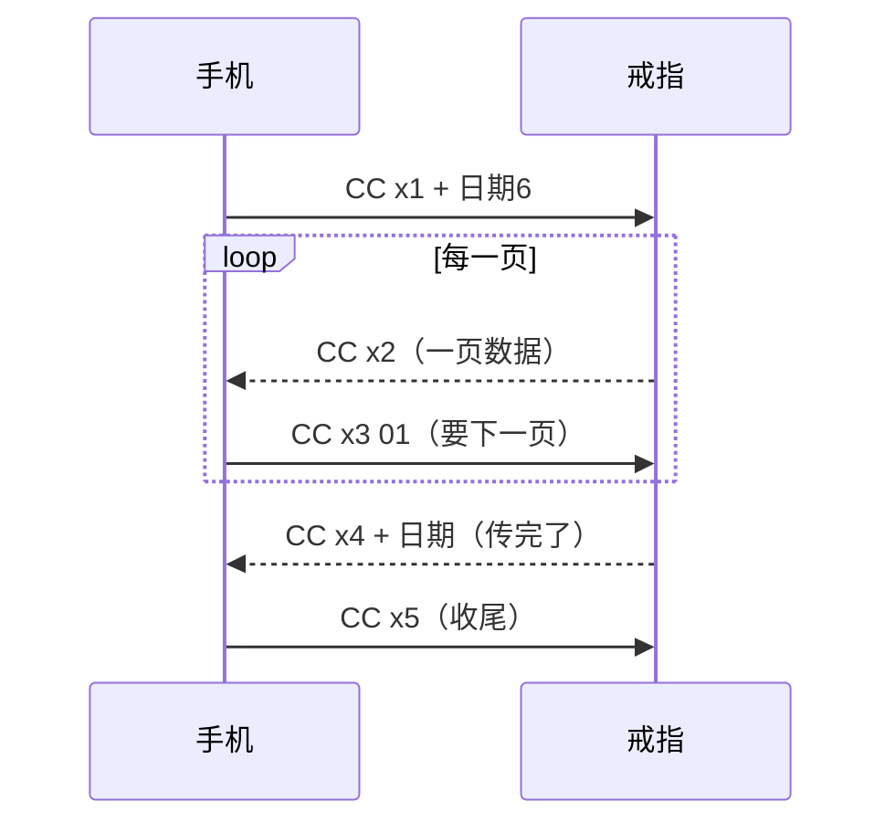

<div align="center">

# 黑鲨1智能戒指蓝牙协议笔记

一款智能戒指的 BLE 通信格式，全部来自抓包实测。


</div>

> [!NOTE]
> 非官方文档，与黑鲨科技无关，仅供学习和互操作研究。
>
> 抓包整理：Kiow & Ray

通信是明文，没有加密。多字节数值没有特别说明的，一律大端。

**目录**　[通道](#1-通道) · [外层封装](#2-外层封装) · [时间格式](#3-时间格式) · [鉴权](#4-鉴权连上后必须先做) · [即时测量](#5-即时测量走-0131) · [状态与设置](#6-状态与设置) · [历史数据](#7-历史数据分页) · [运动](#8-运动) · [定时提醒](#9-定时提醒到点戒指亮灯) · [手势](#10-手势)

## 1. 通道

都是 16 位标准 UUID（`0000XXXX-0000-1000-8000-00805f9b34fb`）。

| UUID | 用途 |
|---|---|
| 服务 `FE02` | 主服务 |
| `0101` | 写：平时的指令 |
| `0131` | 写：「马上测一次」走这条 |
| `010A`、`013A` | 通知：戒指回包（连上后先开通知） |

- MTU 247。
- 戒指平时被系统当成蓝牙键盘连着，**多半不广播**。找它要从已配对 / 已连接的设备里找，别指望扫描。

## 2. 外层封装

每个包都是这个样子：

```
[长度 2] [方向 1] 40 [序号 2] [内容 …] [CRC 2]
```

- **长度** = 内容长度 + 2
- **方向**：`83` = 手机发出，`22` = 戒指发出
- **序号**：每发一包 +1，两个方向各数各的，连上后从 0 开始
- **CRC**：CRC-16/CCITT-FALSE（多项式 0x1021，初值 0xFFFF，不反转，结果不异或），**只算「内容」那段**

例：第 5 包查电量，内容是 `39 01`：

| 长度 | 方向 | 固定 | 序号 | 内容 | CRC |
|:---:|:---:|:---:|:---:|:---:|:---:|
| `00 04` | `83` | `40` | `00 05` | `39 01` | `B2 23` |

下文写的指令和回包，都是指去掉封装后的「内容」。

## 3. 时间格式

- **时间 6 字节**：`年-2000 月 日 时 分 秒`，例 `1A 01 0F 08 1E 00` = 2026-01-15 08:30:00
- **日期 6 字节**（要历史数据用）：`年-2000 月 日 00 00 00`

## 4. 鉴权（连上后必须先做）

```
→ 30 30 01 | 时间6 | 时区1 | 语言1 | 手机厂商1 | App编号32 | ;2.0.3;A1013D00CN1218HE;
← 70 70 01 …        （01 = 成功，35 = 拒绝）
→ 70 71 01
```

- **时区**：UTC 偏移，按小时（东八区 = `08`）
- **语言**：`00` 中文，`01` 其他
- **手机厂商**：`02` 小米（其他取值未确认）
- **App 编号**：32 个 ASCII 字符。戒指可能按它认手机，建议固定用同一串
- 末尾的字符串：`2.0.3` 是 SDK 版本，`A1013D00CN1218HE` 是公司编号，都是明文

## 5. 即时测量（走 `0131`）

| 项目 | 发 |
|---|---|
| 心率 | `31 51 01 01` |
| 血氧 | `31 51 02 01` |
| 体温 | `31 51 06 01` |

回包顺序：`71 51 [项目] 01` 开始测 → 20~30 秒后出结果 → `71 52 [项目] 01` 结束。

- 心率：`71 71 | 时间6 | 心率1`
- 血氧：`72 72 | 时间6 | 血氧%1`
- 体温：`71 75 | 时间6 | 体温×10 (2) | 未知2`（例 `01 6D` = 36.5°C。后两字节疑为环境温度，单位未确认）

## 6. 状态与设置

| 功能 | 发 | 回 |
|---|---|---|
| 电量 | `39 01` | `79 01 00 [百分比]` |
| 当前步数 | `33 33`（不带时间） | `73 73 \| 时间6 \| 步数4 \| 千卡×10 (4) \| 距离 厘米 (4)` |
| 重启 | `10 09 04` | `20 09`，约 2 秒后断开，约 22 秒后能重连 |
| 查触控休眠时长 | `81 19` | `81 29 \| 当前秒2 \| 出厂秒2` |
| 设触控休眠时长 | `81 1A \| 秒2` | `81 2A 01` = 成功 |

- 触控休眠常用档位：12 / 60 / 600 / 1200 秒，超出这几档的值认不认没试。
- 戒指会主动发 `81 27 xx` 报触控休眠状态，疑 `01` = 休眠、`00` = 醒着。

## 7. 历史数据（分页）

三类数据，流程一样：



| x | 内容 |
|---|---|
| 6 | 全天健康记录 |
| 8 | 睡眠概要 |
| 7 | 睡眠分期 |

- 要数据的顺序通常是 6 → 8 → 7。
- 一页没装满时，剩下的位置用 `FF` 填。
- 「传完了」那包里带日期，要跟问的那天对上；戒指有时会把上一项的「传完了」重发一遍。
- 被拿走的数据不会从戒指上删掉，可以重复要。

> [!IMPORTANT]
> 实测：戒指每次连上后，大约只有头半分钟回历史数据，之后就不回了（即时测量照常）。原因不明，所以连上后要尽快要。

### 7.1 全天健康记录 `CC 62`

每条 16 字节，全 `FF` 表示没有了。

- `[0..3]` 时间，32 位按位从高到低：年-2000（6 位）、月（4）、日（5）、时（5）、分（6）、秒（6）
- `[4]` 心率　`[5]` HRV　`[6]` 血氧　`[7]` 压力（实测恒为 0）
- `[8..15]` 64 位，按位从最高位数起：
  - 第 0–22 位：未用
  - 第 23–40 位：当天累计步数
  - 第 41–51 位：环境温度×10（实测恒为 0）
  - 第 52–62 位：体温×10
  - 第 63 位：SOS
- 规律：清醒时约 30 分钟一条、HRV 为 0；睡着后约 5 分钟一条、带 HRV；血氧约 2 小时测一次，其余条为 0；心率为 0 = 没测到。

### 7.2 睡眠概要 `CC 82`

```
00 | 深睡分钟2 | 浅睡分钟2 | 清醒分钟2 | 起夜次数1 | 眼动分钟2 | 总睡眠分钟2 | 时间点…
```

- 总睡眠 = 深睡 + 浅睡 + 眼动，不含清醒。
- 后面是几个时间点（每个 5 字节：年-2000 月 日 时 分，中间夹 `00`/`01` 分隔），依次是入睡、醒来、小睡开始、小睡结束，最后一字节是小睡分钟数。分隔字节的含义未完全确认。

### 7.3 睡眠分期 `CC 72`

```
CC 72 | 睡眠编号4 | 每 8 字节一段 …
```

- `[0..2]` 未知
- `[3]` 疑似该段心率
- `[4..5]` 该段开始时间 = 当天第几分钟（例 `00 9D` = 157 = 02:37）
- `[6]` 未知
- `[7]` 阶段：`1` 浅睡，`2` 深睡，`3` 清醒，`5` 眼动
- 每段时长 = 下一段开始 − 本段开始；最后一段（阶段 3）是醒来的时刻。

## 8. 运动

类型：`10` 跑步，`9` 健走，`11` 骑行（这三种不用手机定位，距离由戒指按步数算；骑行不算距离）。

| 动作 | 发 |
|---|---|
| 问状态 | `96 10`（回 `96 20`） |
| 开始 | `96 11 \| 开始时间6 \| 类型1` |
| 运动中每 5 秒 | `96 36 \| 开始时间6 \| 类型1` → 回 `96 46` 实时数据 |
| 暂停 / 继续 / 结束 | `96 12` / `96 13` / `96 14`，都带 `开始时间6 \| 类型1` |
| 放弃 | `96 15 \| 开始时间6 \| 类型1` |

`96 46`（实时）和 `96 41`（汇总）格式相同：

```
96 4x | 开始时间6 | 类型1 | 状态1 | 已用秒数2 | 千卡×10 (2) | 步数4 | 距离 10米 (2) | 体温×10 (2) | 心率1 | 未知1 | 配速 秒/公里 (2)
```

- 每段开头 15–20 秒步数是 0，之后一次补上（计步有起步门槛）。
- 不足 1 分钟的运动一般不保存。

取历史运动记录：

> [!WARNING]
> 这段流程未逐步验证。

`96 31` → 戒指交一条概要 `96 41` → `96 32 | 开始时间6` 要详细 → `96 42` 一页页给（每页回 `96 33 | 开始时间6`）→ `96 43` 给完 → 回 `96 34 | 开始时间6`。

`96 42` 每页：`指令2 | 开始时间6 | 类型1 | 9 字节未知 | 每 16 字节一条：秒数2 | 千卡×10 (2) | 步数4 | 距离 10米 (2) | 体温×10 (2) | 心率1 | 未知1 | 配速2`

## 9. 定时提醒（到点戒指亮灯）

新增（共 30 字节）：

```
15 11 01 FF FF FF 18 01 00 00 | 编号2 | 00 00 | 年2 | 月 | 日 | 时 | 分 | FF×10
```

例（编号 900，2026-01-15 07:30）：

```
15 11 01 FF FF FF 18 01 00 00 03 84 00 00 07 EA 01 0F 07 1E FF FF FF FF FF FF FF FF FF FF
```

删除：`15 11 04 | 编号2`

戒指回 `15 21 01` = 收到。

> [!TIP]
> 上面这个写法实测能用：写进去后到点戒指亮灯，只响一次。

- 编号前面的 `01 00 00`、编号后面的 `00 00`，含义没完全弄清：推测包含提醒类型、重复方式、提前几分钟，但具体哪个字节对应哪一项未确认。照上面原样填就行。
- 提醒编号建议用大一点的数（比如 900 起），以免跟其他 App 写进戒指的提醒撞号。

## 10. 手势

戒指在「一键魔方」模式下，手势走蓝牙键盘，不走 GATT：

| 手势 | 按键 |
|---|---|
| 长按 | F3 |
| 上滑 | F4 |
| 下滑 | F5 |

单击、双击不发。安卓上要在原生层截按键事件。
也有其他的手势，但是我图方便用了那个一键魔方，因为那玩意完全不知道干嘛用的扒拉了也没反应，所以就顺便拿来用了。要用其他的他那个帧格式是不同的，要自己再抓一下。

---

<div align="center">
<sub>本文档以 <a href="https://creativecommons.org/licenses/by/4.0/deed.zh-hans">CC BY 4.0</a> 协议发布，转载或使用请注明出处：Kiow & Ray。</sub>
</div>